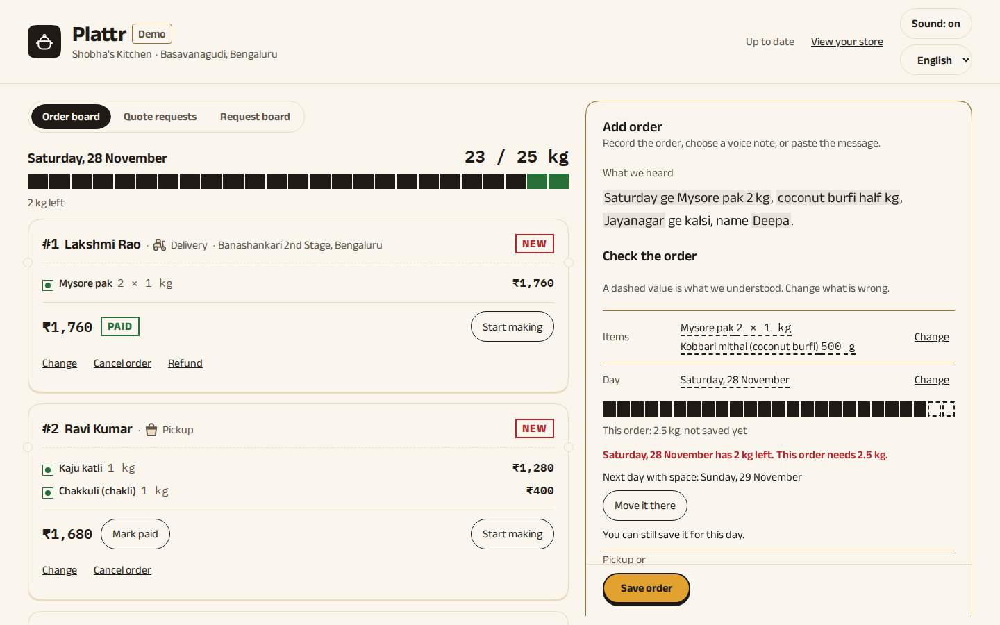
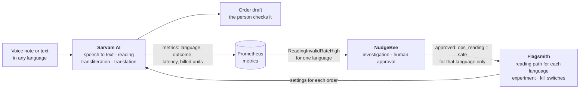
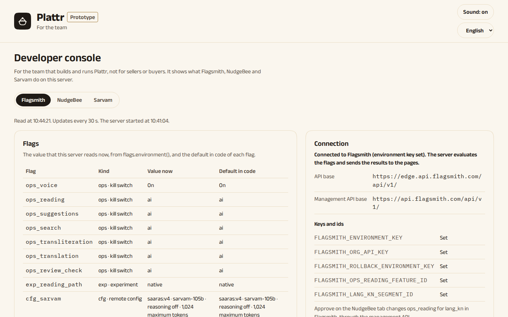
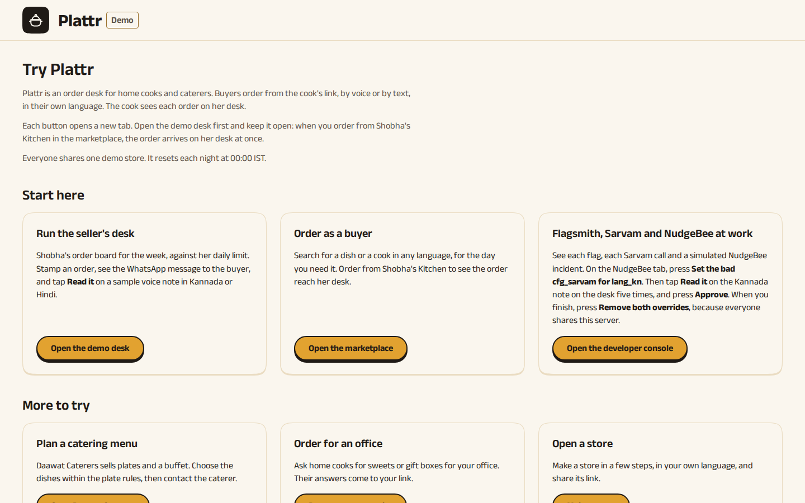
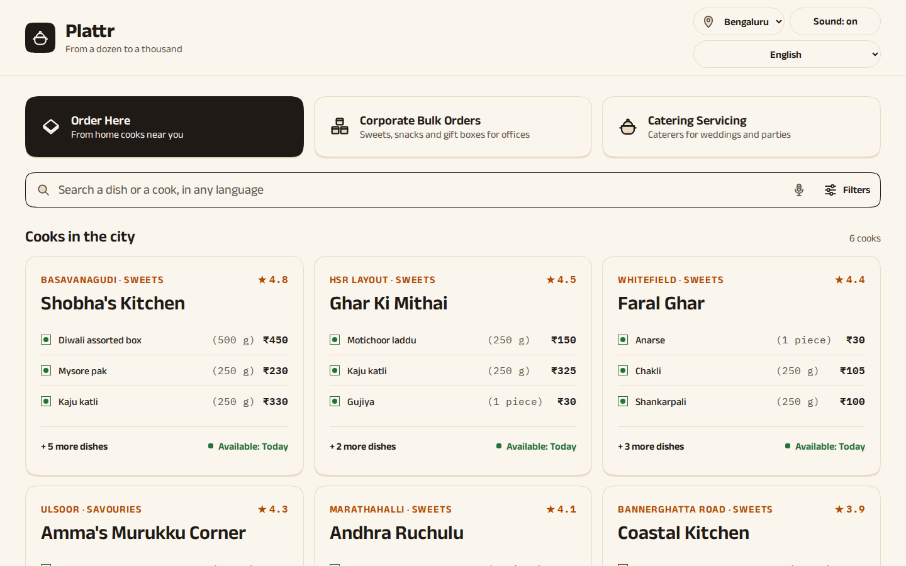
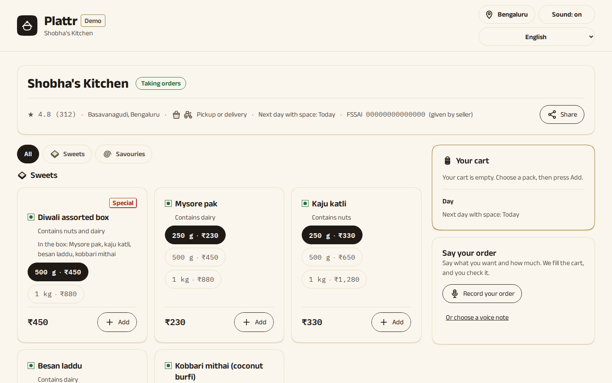

<div align="center">

# Plattr

### From a dozen to a thousand

**Pre-orders for home cooks in the festival rush.**<br>
Buyers order by voice, in their own language. The cook gets an order desk that never promises more than she can make.

<a href="https://plattr-production.up.railway.app/demo"></a>


<br><br>



<sub>A voice note in Kannada and English, read live by Sarvam AI. The dashed values are what the model understood. The desk shows that Saturday has 2 kg left and offers Sunday.</sub>

</div>

---

## The problem

Before a festival, a home cook gets more pre-orders than she can make. All the orders are due before one day. Most orders come as WhatsApp voice notes and texts, in Kannada, Hindi, English or a mix. Every seller has her rush in the same weeks.

## The product

- **A store for each cook.** Buyers find the cook in the marketplace, or open her link. They order by voice or by text, in their own language.
- **Only the days she can make.** Each cook has a daily limit. A buyer sees only the days with space for the whole cart. The app never promises more.
- **An order desk that reads voice notes.** The cook records, uploads or pastes a WhatsApp order. The desk shows the words that it heard and a draft. She checks the draft and saves it.
- **Bulk and catering.** Companies post bulk requests, and event hosts build catering plans within the caterer's rules. These are quote requests: the two sides agree the deal on WhatsApp.

## Try it in two minutes

**Open the start page: [plattr-production.up.railway.app/demo](https://plattr-production.up.railway.app/demo).** It has one link for each side. Each link opens a new tab. All people and stores in the demo are made up. The demo resets each night at 00:00 IST.

1. **Open the demo desk** and keep it open. This is the order board of Shobha's Kitchen.
2. **Search across scripts.** Open the marketplace. Search for `काजू कतली` (Hindi script) or `kaju katli`. Shobha's Kitchen answers, although her menu is in English and Kannada.
3. **Order by voice.** In her store, press **Record your order**. Say: _"Saturday ge Mysore pak 2 kg, coconut burfi half kg, Jayanagar ge kalsi, name Deepa."_ Check the cart. Saturday has too little space, so the app offers the next day with space.
4. **Check out.** Press **Order**. The WhatsApp code shows on the screen, because WhatsApp is a prototype part. Then look at the desk: the order is on the board already. Stamp **Start making**, then **Mark ready**, and open **WhatsApp messages to the buyer**.
5. **See the three services at work.** Open the developer console. The **Flagsmith** tab shows the flags that the server reads from Flagsmith, and the decision for each language. The **Sarvam** tab shows each call, with its latency and billed units. The **NudgeBee** tab shows the readings by language, the alert condition and the NudgeBee run.

> [!NOTE]
> **The incident.** The team adds a bad `cfg_sarvam` override for the segment `lang_kn` in Flagsmith (reasoning on, 256 maximum tokens). Kannada readings then come back cut off. The NudgeBee run on the console asks for approval, and **Approve** sets `ops_reading` to `safe` for `lang_kn` only, in Flagsmith. Hindi and English do not change. On a server with no Flagsmith keys, the console sets the bad override itself. The runbook is in [`docs/system.md`](docs/system.md) ("Incident runbook").

## How Plattr uses Sarvam AI, Flagsmith and NudgeBee

Each service does real work. Each service also feeds the next one. The loop keeps the reading of orders safe at the festive peak.



### Sarvam AI: hears, reads and matches every order

| Job | How the build does it |
|---|---|
| Speech to text | `saaras:v4` in `codemix` mode. The menu of the store goes in as `keyterms`, so dish names come back right. The answer also gives the language. |
| Order reading | `sarvam-105b` with a strict JSON schema. The server matches each item to the menu, changes each amount to the fewest packs ("2 kilo" is 2 × 1 kg), and checks the daily limit. |
| Translate-first path | `mayura:v1` changes a transcript to English first. This is the second arm of the experiment. |
| Search across scripts | Transliteration to Latin letters. `kaju katli`, `ಕಾಜು ಕಟ್ಲಿ` and `काजू कतली` find the same cooks. |
| Names and notes | Item names show in the buyer's script. Notes, board posts and quote requests reach the seller in her language, with the **Translated** badge and the original one tap away. |
| Seller setup | The seller says one item, for example _"chakli, 400 rupees a kilo"_. The app fills in the name, category, food mark and packs. She checks them. |
| Text orders | Language identification picks the language of a pasted WhatsApp message. |

The AI never speaks as the user. Each reading is a draft that a person confirms or edits. Each call is a metric: model, language, latency, outcome and billed units. A Sarvam 402 means no credit: the server does not retry it, and the page offers the manual path.

### Flagsmith: decides how to read each order

| Use | How the build does it |
|---|---|
| A reading path for each language | Each order gets identity flags with the trait `language` (for example `kn-IN`). The segments `lang_kn`, `lang_hi` and `lang_en` hold their own `ops_reading` (`ai`, `safe` or `manual`) and `cfg_sarvam` (model settings). One language can change while the others stay. |
| An A/B experiment | `exp_reading_path` splits orders 50/50 between `native` reading and `translate_first` reading. The metric is `order_saved_unedited`: an order saved with no correction. The identity is the order. |
| A kill switch for each AI feature | `ops_voice`, `ops_reading`, `ops_suggestions`, `ops_search`, `ops_transliteration` and `ops_translation`. Each AI feature has a non-AI fallback: type the order, a manual draft, the item form, a plain text search, the original script or the original text. |
| Remote config | `cfg_sarvam` holds the Sarvam settings. `cfg_demo_trace` shows a one-line trace on each reading: language, path, variant and time. |

Only the server evaluates flags. The browser never calls Flagsmith. Each flag has a default in code, so a Flagsmith timeout never stops an order. `npm run flagsmith-setup` makes the flags, segments, metric and experiment in a new project.

<p align="center"></p>

### NudgeBee: catches a broken language and fixes only that language

| Part | In this build |
|---|---|
| Alert rules | Real PrometheusRules in [`deploy/prometheus-rules.yaml`](deploy/prometheus-rules.yaml). `ReadingInvalidRateHigh` fires for one language when more than 30% of its readings are invalid for 2 minutes. It is the one critical alert, so it is the one that starts an AI investigation. |
| Workflows | Real NudgeBee workflow files in [`nudgebee/`](nudgebee/). One sends each Flagsmith change to NudgeBee as an event. The other waits for the investigation, asks a person to approve, and then sets `ops_reading` to `safe` for the segment `lang_kn` only. It changes only an `ops_` flag. |
| The incident | Runs on the live server, from the developer console (`/ops`). The console checks the real alert condition on the live metrics, shows the investigation, and waits for a person to press **Approve**. Then it makes the same `ops_reading` change as the rollback workflow, in Flagsmith, for `lang_kn` only. |

To run the same files in a NudgeBee tenant, see "Plug in the services".

### Each service is integral

| Without | What breaks |
|---|---|
| Sarvam AI | Voice notes cannot enter the order book. Search loses its matches across scripts. Notes reach the seller only in the writer's language. |
| Flagsmith | No reading path for each language, no experiment, and nothing for NudgeBee to change. |
| NudgeBee | The app works on a quiet day. At the festive peak, one bad setting breaks one language, and nobody knows until the sellers see it. |

## Screenshots

| | | |
|---|---|---|
| <br><sub>**Start page.** One link for each side.</sub> | <br><sub>**Marketplace.** Search a dish or a cook, in any language.</sub> | <br><sub>**Store.** Packs, a voice cart and the next day with space.</sub> |

## Built for trust

- **Status badges tell the truth.** **Demo** marks the demo stores. **Recorded** marks saved Sarvam answers. **Translated** marks each translation. **Prototype** marks each simulated part.
- **The app never loses an order.** If voice fails, the buyer uses the list, and the seller types the order.
- **Undo, not "are you sure?".** Each stamp, cancel and refund has 10 seconds to undo.
- **Privacy by default.** The cook's exact address stays private until a pickup order. Distances start from a 1 km grid cell, not from her pin. Logs never hold phone numbers.

### Prototype parts

This build simulates the services that need business approval or money. Each one shows the **Prototype** badge.

| Part | In this build | In the full product |
|---|---|---|
| WhatsApp codes for sellers and buyers | The code shows on the screen | WhatsApp Business Platform |
| Automatic WhatsApp messages | A message log on the order page and the desk | WhatsApp Business Platform |
| Work email codes for board posts | The code shows on the screen | An email service |
| Payments and refunds | The `/pay/:token` screen, with **Pay** and **Fail** | Razorpay |

**Send on WhatsApp**, **Message the store** and **Contact seller** are real. Each one opens WhatsApp with a `wa.me` link. Voice note uploads are real too.

## The experiment

- **Question:** does native reading need fewer corrections than translate-first reading?
- **Flag:** `exp_reading_path`: `native` (the control) or `translate_first`, split 50/50.
- **Metric:** the count of `order_saved_unedited`. **Identity:** the order.
- **Orders:** voice orders from the team with **Add order** on the desk of the test store `test-kitchen`, in Kannada, Hindi and English. They are not orders from real buyers. The steps are in [`docs/system.md`](docs/system.md) ("Experiment run").

## Architecture

One Node.js service (Hono) serves the pages, the JSON API, `/metrics`, `/healthz` and `/readyz`. The pages use Vite and TypeScript with no UI framework. SQLite holds the data. The desk gets new orders through Server-Sent Events.

| Area | Choice |
|---|---|
| Frontend | 13 pages in semantic HTML, TypeScript, one design system, Web Audio sounds, app text in 6 languages |
| Backend | Hono, zod at each boundary, idempotency keys, timeouts and retries with backoff, one JSON log line for each request |
| Data | SQLite (WAL) with FTS5 trigram search, 14 migrations |
| Observability | Prometheus metrics for each HTTP route and each Sarvam call, five alert rules |
| Quality | Strict TypeScript, Prettier, unit tests with `node:test`, browser tests with Playwright, CI on each push |
| Deploy | One container from the `Dockerfile`. The hosted demo runs on Railway. The k3s manifests in `deploy/` add the NudgeBee agent. |

The full design is in [`docs/system.md`](docs/system.md).

## Run it locally

You need no account and no key. Without keys, the app uses saved Sarvam answers and the flag defaults in code. Screens with saved answers show the **Recorded** badge.

```sh
npm ci            # Node.js 22.18 or later
npm run setup     # makes .env with new secrets and shows the addresses
npm run serve     # builds the pages and starts the server on port 8080
```

Open `http://localhost:8080/demo` in Chrome. Push `Ctrl+C` to stop the server.

<details>
<summary><b>No Node.js on your computer? Use one of these ways.</b></summary>

- **macOS or Linux, with no install.** Run `bash scripts/start-local.sh` in the folder of the repository. The script uses Node.js 22.18 or later if the computer has it. If not, it downloads a private copy of Node.js 22 into `.node/`, and checks it against the official SHA-256 sums. It needs no admin rights. Then it installs the packages, makes `.env` and starts the app.
- **Windows.** In PowerShell, run `winget install OpenJS.NodeJS.LTS`. Open PowerShell again, then do the three steps above.
- **Docker.** Run these commands, then open `http://localhost:8080/desk?demo=local-demo-desk-token&lang=en`:

  ```sh
  docker build -t plattr .
  docker run --rm -p 8080:8080 -e SESSION_SECRET=change-me-to-32-random-characters-0000 -e DEMO_DESK_TOKEN=local-demo-desk-token -e PUBLIC_URL=http://localhost:8080 plattr
  ```

</details>

<details>
<summary><b>If a step fails</b></summary>

- `npm ci` shows `EBADENGINE`: install Node.js 22.18 or later, then do the step again.
- Port 8080 is in use: change `PORT` and `PUBLIC_URL` in `.env`, then start again.
- The page does not open: make sure that the terminal shows `The app runs at`.
- The lines in braces (`{...}`) are the request log. This is correct.
- The terminal shows `Restarting` again and again: move the folder out of OneDrive or other synced folders.
- You forget the address of the demo desk: find `DEMO_DESK_TOKEN` in `.env`.
- You want new demo data: stop the app, delete the folder `data`, and start again.

</details>

<details>
<summary><b>Voice, checks and development</b></summary>

- **Voice.** Use the sample voice notes on the desk, in **Add order**. They have saved answers. A new recording needs a Sarvam key: without it, the page shows the manual path.
- **Unit tests.** `npm test`. They use no network.
- **Browser tests.** `npx playwright install chromium` one time, then `npm run test:e2e`.
- **Settings check.** `npm run doctor` makes one cheap call to each service and shows OK, or the problem and the next step.
- **Development.** `npm run dev` restarts the server when a file in `server/`, `shared/` or `.env` changes. Before a commit, run `npm run format` and `npm run check`.
- **No compile step.** `better-sqlite3` has ready-made binaries, so `.npmrc` turns off install scripts.

</details>

## Plug in the services

Each key, endpoint and mode is an environment variable. [`.env.example`](.env.example) lists each one, where to get it, and what happens without it. Put the keys in `.env`, never in git. After each change, restart the server and run `npm run doctor`.

<details>
<summary><b>Sarvam AI</b></summary>

1. Make a Sarvam account and verify it. A verified account gets free credit.
2. Make a key at https://indus.sarvam.ai/key-management. The dashboard shows the key one time only.
3. Set `SARVAM_API_KEY` and `SARVAM_MODE=live`. With `live` and no key, the server does not start.

The saved answers in `fixtures/sarvam/` are placeholders. To record real ones, put the voice lines of [`docs/demo-data.md`](docs/demo-data.md) in `fixtures/sarvam/audio/<line id>.wav` (16 kHz mono 16-bit, 29 s or less). Then run `npm run record-fixtures`. Use `--dry-run` first: it lists the calls and uses no credit. Each live call of a script goes into the git-ignored `usage.log`.

</details>

<details>
<summary><b>Flagsmith</b></summary>

1. Make an organisation and a project. Keep the two default environments: Development for your computer, Production for the live server. The Free plan is enough.
2. In each environment, turn on the warehouse (Environment Settings, Warehouse). The experiment needs it.
3. Set `FLAGSMITH_ENVIRONMENT_KEY` (the server-side key of the environment), `FLAGSMITH_ORG_API_KEY` (Organisation Settings, API Access) and `FLAGSMITH_PROJECT_ID` (the number in the dashboard address).
4. Run `npm run flagsmith-setup`. It makes the flags, segments, metric and experiment. It prints three values for the rollback: `FLAGSMITH_ROLLBACK_ENVIRONMENT_KEY`, `FLAGSMITH_OPS_READING_FEATURE_ID` and `FLAGSMITH_LANG_KN_SEGMENT_ID`.
5. Give the three values and `FLAGSMITH_ORG_API_KEY` to the server. Then **Approve** on `/ops` changes Flagsmith. Without them, **Approve** changes an override in the memory of the server, and says so.

</details>

<details>
<summary><b>NudgeBee, for a tenant</b></summary>

1. Ask NudgeBee for a tenant: sign-up is by email, at contact@nudgebee.com. In the tenant, turn on "Automatic event analysis". Make an API token for `nbctl`: `NUDGEBEE_API_TOKEN`.
2. Use the k3s path (see "Deploy"), because the NudgeBee agent runs in the cluster. Install the agent as [`docs/nudgebee.md`](docs/nudgebee.md) says. Its Prometheus scrapes the app and loads the alert rules.
3. Load the two workflows: `nbctl workflow validate <file>`, then `nbctl workflow apply <file>`, for each file in `nudgebee/`. Do not use Dry Run on the rollback: it sends the real change.
4. Set `NUDGEBEE_FLAG_WEBHOOK_URL` to the Automation Webhook URL of the flag-change workflow. Run `npm run flagsmith-setup` again. Each flag change then shows as a NudgeBee event.

</details>

## Deploy

Both paths run the one image of the `Dockerfile`. SQLite and the photos are in `DATA_DIR` (`/data` in the image). `/healthz` is the liveness check, and `/readyz` is the readiness check. On SIGTERM, the server stops new requests, finishes the current requests, and exits. The server does not show `/metrics` to requests that come through a proxy.

<details>
<summary><b>Railway: the hosted demo</b></summary>

1. Make a Railway project with one service. Deploy this repository to it from GitHub, or run `railway up` in its folder. Railway builds the `Dockerfile`.
2. Make a public domain for the service (Settings, Networking).
3. Set the variables: `SESSION_SECRET`, `DEMO_DESK_TOKEN`, `PORT=8080` and `PUBLIC_URL` (the domain, with no trailing slash). For live Sarvam, add `SARVAM_MODE=live` and `SARVAM_API_KEY`. For Flagsmith, add `FLAGSMITH_ENVIRONMENT_KEY` and the rollback values.
4. Add a volume at `/data` to keep the data across restarts. Without a volume, the database starts empty at each restart, and the server makes the demo data again.
5. Open `https://<domain>/healthz`. It answers `{"status":"ok"}`.

</details>

<details>
<summary><b>k3s: with the NudgeBee agent</b></summary>

1. Make a VM with a static IP address and the open ports 22, 80 and 443. The address is the sslip.io name of the IP: `34.12.56.78` gives `34-12-56-78.sslip.io`.
2. Install k3s and cert-manager. Put the hostname in place of `0-0-0-0.sslip.io` in `deploy/ingress.yaml` and `deploy/configmap.yaml`. Use the Let's Encrypt staging issuer until HTTPS works, then `letsencrypt-prod`.
3. Install the NudgeBee agent ([`docs/nudgebee.md`](docs/nudgebee.md), "Agent install").
4. In GitHub, add the Actions secrets `DEPLOY_SSH_KEY`, `SESSION_SECRET` and `DEMO_DESK_TOKEN` (and `SARVAM_API_KEY` and `FLAGSMITH_ENVIRONMENT_KEY` if you use them). Add the Actions variables `DEPLOY_HOST`, `DEPLOY_USER` and `DEPLOY_KNOWN_HOSTS`.
5. Push to `main`. CI checks the format, the types, the unit tests and the browser tests. Then it builds the image, does a smoke test, pushes the image to GitHub Container Registry with the git SHA as its tag, and deploys over SSH.
6. Make the package in GitHub Container Registry public, so that k3s needs no pull secret.

The design of both paths is in [`docs/system.md`](docs/system.md) ("Deployment").

</details>

## How we built it: spec first

The docs came before the code. Each doc owns its facts, and the other docs point to them.

| File | What it decides |
|---|---|
| [`AGENTS.md`](AGENTS.md) | The rulebook that the coding agents followed, and the map of the docs. [`CLAUDE.md`](CLAUDE.md) points to it. |
| [`docs/concept.md`](docs/concept.md) | The users, the problem, the user flows, the product rules, and what is on the roadmap. |
| [`docs/integration.md`](docs/integration.md) | The job of each service, and the three connections between them. |
| [`docs/system.md`](docs/system.md) | Architecture, data, API, the reading pipeline, flags, the experiment run, metrics, alerts, the incident runbook, deploy and tests. |
| [`docs/demo-data.md`](docs/demo-data.md) | The demo stores, menus, prices and voice lines. |
| [`docs/sarvam.md`](docs/sarvam.md), [`docs/flagsmith.md`](docs/flagsmith.md), [`docs/nudgebee.md`](docs/nudgebee.md) | The checked facts about each service that the build depends on. |
| [`docs/practices.md`](docs/practices.md) | The reasons, speed budgets and sources behind the rules. |
| [`docs/design.md`](docs/design.md) | The visual direction, colour, type, icons, motion and copy style. |
| [`docs/sound.md`](docs/sound.md) | The one family of sounds (one raag, one room), their roles, and the engine. |
| [`extra/`](extra/) | The design rounds, as swatch pages for type, components, icons and sound. |

## How we used AI

- **The code.** AI coding agents (Claude Code) wrote the code, the tests and the deploy files, from the spec in `docs/` and the rules in `AGENTS.md`. They worked in waves, each agent on its own folders. Each wave was checked (Prettier, `tsc` and the tests) and reviewed before the next one started. The team did not write the code by hand. The team's part was the spec, the decisions and the reviews, and the team can explain each line.
- **The spec and the design.** The team chose the problem, the scope and each decision in `docs/`. AI assistants helped to research the three services and to write the docs. The swatch pages in `extra/` are options that AI agents made. The team chose between them by eye.
- **This README and the demo video script.** A coding agent drafted them, and the team edited them.
- **AI in the product** is Sarvam only. The AI never speaks as the user. Each AI feature has a non-AI fallback behind an `ops_` flag.

## Roadmap

| Area | Next |
|---|---|
| Buyers | **My orders**, reviews with the Sarvam Prism check for abuse, real ratings, the full privacy page, and delete my data. |
| Sellers | The "Make your store better" checklist. Edit the store, menu, prices and link after publishing. Item photos and the **Special** tag in setup. Who owes, and payment reminders. Web push for the desk. Delete the store. |
| AI | Item, pack and category suggestions as quick buttons, and festive suggestions. A spoken note on **I can do this**. |
| WhatsApp | Orders forwarded to the app's own number. The buyer's number on desk orders. A message to the matching stores for each board post. An automatic answer on the app's number. |
| Platform | The NudgeBee agent in the cluster, and the workflows in a NudgeBee tenant. Razorpay for payments and refunds. Phone layouts, real WhatsApp, real email, and a bought domain. |

## How it could earn

The app is free for sellers and buyers. Later, it could earn from a small fee on online payments, or from a paid plan for bulk and catering leads. Payouts to sellers are a later option: Razorpay Route needs an eligible business.

## Credits and licence

Plattr is released under the [MIT License](LICENSE).

- **Fonts**, self-hosted in `src/fonts/`, each with its licence file: **Anek** by Ek Type (SIL Open Font License 1.1, [`anek-OFL.txt`](src/fonts/anek-OFL.txt)) and **IBM Plex Mono** by IBM (SIL Open Font License 1.1, [`ibm-plex-mono-OFL.txt`](src/fonts/ibm-plex-mono-OFL.txt)).
- **Method.** The design-round method of `extra/` and the model of the sound engine come from [Spaceship](https://github.com/chuanqisun/spaceship) by Chuanqi Sun (MIT).
- **Icons and sounds.** The icons were drawn for this project. The sounds are made in the browser with the Web Audio API, with no audio files.
- **Container image:** `node:22-slim` (Node.js, MIT).

<details>
<summary><b>npm packages</b></summary>

Each package keeps its licence file in `node_modules/`.

| Package | Version | Licence | Use |
|---|---|---|---|
| `hono`, `@hono/node-server` | 4.13, 2.1 | MIT | The HTTP server |
| `zod` | 4.6 | MIT | One schema for each external input |
| `better-sqlite3` | 13.2 | MIT | SQLite with FTS5. SQLite itself is in the public domain |
| `@flagsmith/nodejs` | 9.5 | MIT | Flags and experiment events |
| `prom-client` | 15.1 | Apache-2.0 | Metrics |
| `qrcode` | 1.5 | MIT | The QR code of the store link |
| `vite` | 8.3 | MIT | Build and dev server (development only) |
| `typescript` | 7.0 | Apache-2.0 | Type checks (development only) |
| `prettier` | 3.10 | MIT | Formatting (development only) |
| `@playwright/test` | 1.65 | Apache-2.0 | Browser tests (development only) |
| `@types/node`, `@types/better-sqlite3`, `@types/qrcode` | 22, 9.6, 1.5 | MIT | Types (development only) |

</details>
